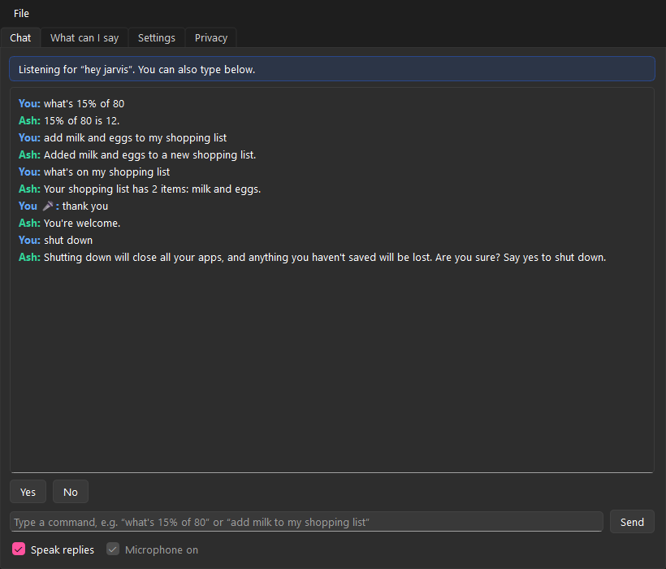

# Ash

[](https://github.com/swns1/offline-voice-activated-personal-assistant-system/actions/workflows/tests.yml)

**An offline, privacy-first voice assistant for Windows.** Say "hey
Jarvis", then a command. The wake word, speech recognition, command
handling and voice all run on your PC, with no cloud speech service.
The few features that need the internet ask first, can be switched off
with offline mode, and leave a record you can read.



| | What you can say or type |
|---|---|
| **Apps and windows** | "open Spotify", "launch Elden Ring", "close Discord" (asks first), "minimize this window" |
| **Quick answers, offline** | "what time is it", "what day is Christmas", "what's 15% of 80", "convert 5 miles to kilometers" |
| **Timers and reminders** | "set a timer for 10 minutes", "remind me at 3pm to call mom", routines |
| **Notes and lists** | "add milk and eggs to my shopping list", "what's on my shopping list", "take a note buy flowers for mom" |
| **Music and video** | "pause", "next track", "what's playing" (any app); Spotify search and play |
| **Your PC** | volume, brightness, dark mode, battery, storage, screenshot, lock, sleep, shut down (asks first) |
| **Calendar and email** | "what's on my calendar", "check my email", "email Anna saying I'm running late" (Outlook; sending asks first) |
| **Files** | "find my resume", "open my latest download" (Windows Search, offline; never opens programs) |
| **Online, with consent** | weather (Open-Meteo), "what is the Eiffel Tower" (DuckDuckGo) |
| **Local AI, optional** | conversation, translation, "what's on my screen", multi-step commands, memory (Ollama on this PC) |
| **Privacy** | "go offline", "what data do you have", "what have you sent online", "export my data", "delete all my data" |

Ash also has a desktop window for typing instead of talking. It has a
privacy dashboard, settings, and a list of every command (see
[Running](#running)).

**How it's built:** pretrained deep-learning models run on the PC:
openWakeWord for the wake word, and Whisper (through CTranslate2) for
speech recognition. A rule-based command grammar is generated from one
catalog of skills, and every command runs on a single worker thread
shared by voice and the window. A privacy layer adds DPAPI encryption,
a single audited network gate, consent, and a data inventory. There are
about 1,000 tests, run on Windows CI. See
[docs/ARCHITECTURE.md](docs/ARCHITECTURE.md).

### Measured

From the end of a spoken command to the first word of the reply, Ash
takes about **1.1 seconds** with speech recognition on an NVIDIA
graphics card (RTX 4060), or **2.8 seconds** on the processor alone
(Ryzen 5 5600, 6 cores). Measured with `scripts/benchmark.py`: 30 runs
of 10 offline commands, spoken by a Windows voice.

| Stage | Median, GPU | Median, CPU only |
|---|---|---|
| Waiting for 900 ms of silence (`audio.silence_ms`) | 900 ms | 900 ms |
| Speech to text (Whisper small) | **139 ms** | 1.8 s |
| Understanding and running the command | 0.1 ms | 0.1 ms |
| Start of the spoken reply (Windows voice) | 47 ms | 45 ms |

On the GPU, most of the remaining wait is the pause Ash waits for to be
sure you've finished; `audio.silence_ms` sets it. The graphics card is
used automatically if it can be (`speech.device: auto`). It needs one
optional install:

```
.venv\Scripts\pip install -r requirements-gpu.txt
```

That's NVIDIA's cuBLAS library, about 900 MB, only useful with an NVIDIA
card. Without it, or if anything goes wrong on the GPU, Ash uses the
processor, as before. `--selftest` says which one is in use. On the
same 50 recordings, the GPU (int8_float16) got the same 94% of commands
right as the CPU.

On the processor, speech recognition was most of the wait, so it was
worth checking whether a smaller, faster model would do. `scripts/stt_accuracy.py`
recorded one speaker saying 50 of Ash's commands, then ran each
Whisper model size on them, with and without **command hints**: Ash's
command words given to Whisper as hotwords (`ash/audio/vocabulary.py`).

| Whisper model | Word error rate | Commands run correctly | Median time per command (CPU) |
|---|---|---|---|
| tiny | 17.1% | 72% | 0.29 s |
| tiny + command hints | 16.0% | 78% | 0.30 s |
| base + command hints | 13.7% | 76% | 0.59 s |
| small | 12.6% | 86% | 1.82 s |
| **small + command hints (what Ash uses)** | **5.7%** | **94%** | 1.94 s |

"Commands run correctly" is stricter than it sounds: the same command,
with the same words for what it acts on (app names are compared
fuzzily, as Ash matches them). The smaller models are 3 to 6 times
faster but get about 1 command in 4 wrong, so Ash keeps small. The
hints more than halve its word errors for about 0.1 s more. Short
command words were the problem: "pause" heard as "boss", "list" as
"lease", "city" as "CT". Two of the three remaining misses were
recordings where the phrase was said twice. The study also found
wording Ash didn't accept ("what is my city", "goto sleep", "set the
timer for"); those are fixed. Free-form sentences (searches, notes)
transcribed the same with and without the hints.

Limits: one speaker and 50 short commands. Record your own with
`scripts/stt_accuracy.py`, which keeps the recordings in a folder you
choose.

## Privacy

Ash's privacy features are designed in line with the principles of the
Philippine Data Privacy Act of 2012 (RA 10173). The full assessment —
what's stored, what leaves the PC, how each feature maps to the Act,
the threat model, and how to verify it yourself — is in
[docs/PRIVACY.md](docs/PRIVACY.md). In short:

- **Encrypted at rest.** Everything personal Ash stores — remembered
  facts, timers and reminders, your voiceprint, and your Spotify login
  token — is encrypted with Windows DPAPI, so only your Windows account
  can read it (not other accounts on this PC, and not anyone who copies
  the files off it). Files from older versions of Ash are converted
  automatically the first time Ash reads them. Audio is never saved to
  disk.
- **Logs don't record what you say.** The log files (for
  troubleshooting) show which command ran, not its content: what you
  said, searched for, or asked to be reminded about appears as e.g.
  `<4 words hidden>`. Text Ash types for you and facts you ask it to
  remember are never logged at all. Set `privacy.log_transcripts: true`
  in `config/config.yaml` to include the content while troubleshooting.
- **Logs are kept for 7 days.** A new log file starts each day, and files
  older than `privacy.log_retention_days` (default 7) are deleted
  automatically.
- **Nothing goes online without asking — asked once, at setup.** The
  first time Ash starts, before it says "Ash is listening", it asks
  about each feature that needs the internet, saying exactly what it
  would send and to whom — e.g. "To answer 'what is' and 'search for'
  questions, I'd send the words you search for to DuckDuckGo, over the
  internet. Is that okay?" — and remembers your answers, so you're never
  interrupted mid-command. A feature you set up later (e.g. Spotify) is
  asked about the next time Ash starts. If you don't answer, nothing is
  sent: Ash asks again next start, or when you first use that feature.
  A "no" is respected, not asked again. Change your mind any time:
  "allow web search" / "stop allowing Spotify".
- **Offline mode.** "go offline" blocks everything that would leave
  this PC, whatever you've allowed; "go online" turns it back off.
  Talking to Ollama on this PC is unaffected (it never leaves the
  machine).
- **You can check what went online.** Every request that leaves this PC
  is recorded in an encrypted network log — when, which feature, which
  website, and what *kind* of data, never the data itself — kept for 30
  days. "what have you sent online" gives you the summary. In the code,
  every web request goes through one module (`ash/privacy/egress.py`),
  and a test fails if anything else tries to make one.
- **Your data rights, by voice:**
  - "what data do you have" lists what Ash keeps about you right now
    (e.g. "2 remembered facts, 1 timer or reminder, your voiceprint, and
    a log of 4 times I went online"), and whether it's encrypted.
  - "export my data" saves a readable copy to your Documents folder —
    after warning you that the copy isn't encrypted. Your voiceprint and
    Spotify login are listed but never copied out.
  - "delete my voiceprint" / "delete all my data" erase it, after
    saying exactly what will be lost. Deleting everything also stops
    pending reminders and resets online-feature permissions.
  - "forget that …" corrects a remembered fact (see "Persistent memory").

  All of these work from one list of everything Ash stores
  (`ash/privacy/inventory.py`, with each item's purpose and how long
  it's kept); a test fails if Ash ever stores a file that isn't on it.

## Setup

**The packaged app:** download `Ash-<version>-windows.zip` from the
[releases page](https://github.com/swns1/offline-voice-activated-personal-assistant-system/releases),
unzip it anywhere you can write to (e.g. your Documents folder), and run
`Ash\Ash.exe`. On first start Ash asks before downloading its speech
models: the wake-word model from the openWakeWord project, and the
speech-recognition model from Hugging Face (about 475 MB together, once).
To check everything works: `Ash.exe --selftest > selftest.txt`.

**From source** (Python 3.11+; developed on 3.13):

```
python -m venv .venv
.venv\Scripts\pip install -r requirements.txt
.venv\Scripts\pip install -e .
.venv\Scripts\python.exe scripts\download_wake_word_models.py
```

The last step downloads openWakeWord's pretrained model files once (the
window offers to do this too). The speech-recognition model downloads
the first time Ash starts. Optional extras, each a separate install:
[Ollama](https://ollama.com) with `ollama pull llama3.2` for the local AI,
and [Tesseract](https://github.com/UB-Mannheim/tesseract/wiki) for
reading on-screen text.

`.venv\Scripts\python.exe -m ash --selftest` checks every engine loads
(wake word, speech recognition, voice, encryption, window) without
speaking, listening or downloading anything.

## Running

```
.venv\Scripts\python.exe -m ash
```

This opens Ash's window, with a tray icon (blue: waiting for the wake
word, green: listening, grey: microphone off). Closing the window hides
it to the tray and Ash keeps listening; quit from the tray icon's menu.
The window has four tabs:

- **Chat**: type to Ash instead of speaking. Everything said either way
  appears here. Yes/no questions ("Are you sure?") get Yes/No buttons,
  and you can answer by voice, typing or clicking, whichever is easiest.
  Untick "Speak replies" to read the replies instead of hearing them;
  "Microphone on" switches the microphone off completely (Windows'
  microphone-in-use indicator goes away). The conversation is never
  saved.
- **What can I say**: every command, with examples, generated from the
  command list itself. Double-click an example to try it.
- **Settings**: the everyday options from `config/config.yaml`, saved
  back into it with its comments kept, and your city for the weather.
- **Privacy**: offline mode; an on/off switch for each online feature,
  saying what it sends and to whom; what Ash stores, whether it's
  encrypted and how long it's kept; the network log; and export, delete
  my voiceprint, delete all my data (which ask first, as they do by
  voice).

To run voice-only in the terminal, as before the window existed:
`.venv\Scripts\python.exe -m ash --console` (or set `gui.enabled: false`).
A pystray tray icon then appears (right-click for "Open logs folder" /
"Quit Ash"); set `tray.enabled: false` to turn that off.

How it fits together: every command, from the microphone, the chat box
or a button, runs on one worker thread (`ash/core.py`), in the order it
arrived, so voice and typing at the same time can't trip over each other
or over Ash's data files. A follow-up question stays open there rather
than in whichever input asked it, which is why it can be answered from
any of them.

Speak the configured wake word (`hey_jarvis` by default — see
`config/config.yaml`), then a command such as "open notepad" or "what
is the Eiffel Tower". Say "what can you do" for a quick spoken
tour of the kinds of things Ash can do.

If a command is ambiguous (e.g. two similarly-named apps, or more than
one browser profile with none pinned in config), Ash asks a clarifying
follow-up question — no wake word needed for your answer, just speak it
within a few seconds.

Ash remembers the last app you opened, search you made, and Spotify
track you played, so "open discord" then "close it", or "search for
pizza" then "search that again", resolves "it"/"that"/"this" instead
of needing everything repeated. ("pause"/"resume"/"skip" already work
on whatever's currently playing without needing this — Spotify tracks
that itself.)

Say "stop" (or "cancel", "be quiet") anytime to interrupt whatever Ash
is currently saying — or just start talking over it (barge-in): if you
speak while Ash is mid-response, it stops and starts listening to what
you're saying instead, no wake word needed. This is plain VAD-based
speech detection with no acoustic echo cancellation, so on hardware
where the mic picks up the speakers directly (no headset, a laptop's
built-in mic sitting right next to its speakers), Ash's own voice can
occasionally trigger a false barge-in on itself. Set
`audio.barge_in_enabled: false` in `config/config.yaml` if that happens
on your setup.

## Search

"search for X" / "what is X" / "look up X" answers directly via
DuckDuckGo's free Instant Answer API (`search.enabled: true` in
`config/config.yaml`, on by default) — no account or key, but coverage
is patchy: great for named topics ("Eiffel Tower", "Python programming
language"), nothing for question-style phrasing, calculators, or
dictionary lookups. If it can't find an answer, it says so and suggests
the explicit browser-opening phrasing instead: "search in browser for
X" always opens a real search in your browser (with profile-picking, if
you have more than one), regardless of whether DuckDuckGo has anything.

## Calendar

Reads and adds to your local desktop Outlook calendar via COM — off by
default (`calendar.enabled: false`), and only works if Outlook itself is
installed and configured (no separate account setup needed on Ash's
side). "what's on my calendar" / "what's my next meeting" speaks what's
coming up in the next 24 hours; "add to my calendar team meeting at
3pm" always asks for confirmation with the actual details before
writing anything ("Add 'team meeting' to your calendar at 3pm?").

Ash is otherwise 100% reactive — it never speaks unless spoken to.
Setting `calendar.proactive_reminders: true` (needs `calendar.enabled:
true` too) is the one deliberate exception: it checks your calendar in
the background and speaks + shows a toast a few minutes before a
meeting starts, unprompted. Each meeting is only ever announced once.
Tune how far ahead and how often it checks with
`calendar.proactive_lookahead_minutes` (default 5) and
`calendar.proactive_poll_seconds` (default 60). Off by default — this
is the one feature where Ash initiates speech on its own, so it's worth
turning on deliberately rather than defaulting into it.

## Email (Outlook)

With `email.enabled: true` (or Settings > Answers > Outlook email) and
desktop Outlook set up:

- "check my email": how many are unread, and who the latest three are
  from, with their subjects. Ash never reads the messages themselves
  out loud.
- "email Anna saying I'm running late": Ash looks Anna up in Outlook's
  address book, then tells you exactly what it's about to send, and to
  whom, before asking. For example: "I'll email Anna Reyes,
  anna@example.com, with the subject 'I'm running late', saying: 'I'm
  running late.' Send it?" Only a clear yes sends it. If more than one
  contact matches, nothing is sent. Say just "email Anna" and Ash asks
  what it should say. An address said out loud ("bob at example dot
  com") works too.

Nothing about your email is stored, and neither addresses nor message
text appear in Ash's logs.

## Finding files (offline)

- "find my resume", "where is my tax return", "search my files for
  invoice": searches file names with the Windows Search index, the same
  one File Explorer's search box uses, so it's instant and stays on this
  PC. Only your own user folder is searched, never AppData (program data
  and caches). Ash says the newest match, where it is and when it
  changed, then asks "Open it?".
- "open my latest download": the newest file in your Downloads folder,
  after asking. **Programs and scripts are never opened by voice**
  (`.exe`, `.msi`, `.bat`, `.ps1`, shortcuts and the like). Downloads are
  the usual way malware arrives, so Ash shows them in File Explorer
  instead and leaves the decision to you.

## Quick answers (offline)

Answered from this PC, with nothing sent anywhere — so they work in
offline mode and never need permission:

- Time and date: "what time is it", "what's the date", "what day is
  Christmas", "what day is December 25", "how many days until New
  Year's Eve"
- Maths: "what's 15% of 80", "what is 12 times 7", "calculate 2 to the
  power of 10", "what's the square root of 144" — worked out by a small
  evaluator that only understands numbers and arithmetic (never
  Python's `eval`), so no spoken input can run code
- Unit conversions: "convert 5 miles to kilometers", "what's 100
  degrees Fahrenheit in Celsius", "how many feet are in a mile"
  (distance, weight, volume, speed, temperature and more, via `pint`;
  not currencies, which need live exchange rates)

- Weather (online, via the free Open-Meteo service): first tell Ash
  your city — "my city is Manila" — then "what's the weather", "what's
  the weather tomorrow", "will it rain on Friday", "do I need an
  umbrella", or anywhere: "what's the weather in Tokyo". Ash never
  works out your location; after looking your city's name up once it
  sends only its map coordinates. Your city is stored encrypted ("what's
  my city", "forget my city"), and weather is asked about once, like
  every online feature. `weather.units` in `config/config.yaml` switches
  to Fahrenheit.

"what is …" questions are tried as maths first, so a calculation never
goes to web search — and "how many people live in Manila" still does.

## Notes and lists

- Notes: "take a note: buy flowers for mom", "note that the wifi
  password is on the fridge", "read my notes" (the latest five, newest
  first), "delete my notes" (asks first)
- Lists: "add milk, eggs and bread to my shopping list", "what's on my
  shopping list", "cross milk off my shopping list", "clear my shopping
  list" (asks first), "what lists do I have" — any list name works
  ("to-do", "packing", ...)

Stored encrypted on this PC (`%LOCALAPPDATA%\Ash\notes.json`), and
included in "what data do you have", "export my data" and "delete all
my data".

## System control

- Volume: "volume up" / "volume down" / "set the volume to 50" / "mute" / "unmute"
- Battery and storage: "what's my battery", "how much storage do I have"
- Screenshots: "take a screenshot" (saved to Pictures\Screenshots)
- Brightness: "set the brightness to 60", "brightness up", "dim the
  screen" — built-in laptop screens only; most desktop monitors can't be
  dimmed by software, and Ash says so
- Theme: "turn on dark mode", "switch to light mode"
- Windows: "close discord" force-quits the app — so it first says what
  will be closed and that anything unsaved in it will be lost, and asks
  "are you sure?" (if the name matches several different programs, it
  names each one). "close this window" / "minimize this window" act on
  whatever's currently focused; closing a window this way is a normal
  close, so the app can still ask you to save.
- Timers: "set a timer for 5 minutes", "remind me at 3pm to call mom",
  "remind me every day at 8am to take medicine" (recurring — daily or
  "every weekday"), "cancel my timer", "list my timers" — timers survive
  a restart; if one should have fired while Ash was closed, it's
  announced as soon as Ash starts back up (a recurring one reschedules
  itself for its next occurrence). Alerts also show as a Windows
  notification, not just spoken.
- Routines: "run my `<name>` routine" runs a named sequence of steps you
  define under `routines:` in `config/registry.yaml` (e.g. a "good
  morning" routine that sets the volume, opens Spotify, and lists your
  timers — see the commented example in that file). A risky step in a
  routine (e.g. shut down) still asks first, exactly as if you'd said it.
- Power: "lock my computer", "go to sleep", "shut down". Lock and sleep
  happen right away (nothing is lost). Shut down first explains that all
  your apps will close and anything unsaved will be lost, then asks "are
  you sure?" — only a clear yes ("yes", "yeah", "sure", "go ahead", ...)
  goes ahead; anything else, or no answer, cancels.
- Diagnostics: "are you working" / "run diagnostics" checks the
  microphone, whether Ollama is running (and has its model downloaded),
  and, if enabled, whether Spotify is connected
  — also available standalone via `scripts\selftest.py`, no need to
  talk to Ash for it.

### Voice-verified confirmation (optional)

By default, confirming a risky action (shutting down, force-closing an
app, clicking/typing on screen) just needs a spoken "yes" — anyone in
earshot. Set
`security.voice_gate_enabled: true` for an extra check on top of that:
the confirmation itself has to sound like you, not just be an
affirmative word, checked against a voiceprint you enroll once:

```
.venv\Scripts\python.exe scripts\enroll_voice.py
```

Speak naturally for the few seconds it records (a sentence or two, not
just "yes" — a longer sample makes for a better reference). Worth being
upfront about what this actually is: a classical MFCC-similarity check,
not a trained deep speaker-embedding model (those need a `torch`-based
multi-GB install — the same tradeoff that already ruled out training a
real "Hey Ash" wake word, see below). Treat it as a soft additional
check appropriate for a single-user machine, not a strong biometric
guarantee — `security.voice_match_threshold` (default `0.85`) tunes how
strict it is. If nothing's enrolled, or the check can't run for any
reason, it fails open — you get the same plain yes/no you had before
turning this on, never a shutdown you can't confirm at all.

## Local AI (Ollama)

Anything you say that isn't a known command and doesn't match an app
gets asked to a local language model instead of "I'm not sure what you
mean" — no cloud, no account, runs entirely on your PC via
[Ollama](https://ollama.com):

1. Install Ollama (separate installer, not a pip package) from
   https://ollama.com (or `winget install Ollama.Ollama`). It runs as a
   local background server.
2. Pull the model: `ollama pull llama3.2` (2 GB, one-time).
3. For translation, optionally `ollama pull gemma3:4b` (3.4 GB). See
   "Translation" below for why.

That's it — no config change needed. With `ollama.enabled: auto` (the
default), Ash uses the local-AI features whenever Ollama is running with
that model downloaded, and quietly does without them when it isn't: it
just says "I'm not sure what you mean" as before. It re-checks every 30
seconds or so, so starting Ollama after Ash (e.g. both launching at
login) is picked up without a restart. Ash prints whether local AI is on
when it starts, and "run diagnostics" reports it too. Set
`ollama.enabled: true` or `false` to force it on or off instead.

Replies take a few seconds; Ash says "Let me think" while it waits.
Measured on an RTX 4060 (8 GB): about 2.5 seconds once the model is
loaded. The first request after Ollama loads the model is slower, so Ash
gets the model ready in the background when it starts. On a PC without a
graphics card Ollama runs on the CPU and is several times slower. It
remembers the last few exchanges, so a follow-up like "what's its
population" after "what's the capital of France" works; say "stop" to
end the conversation early.

### Understanding phrasing that doesn't match a template

Ash's command parsing is a fixed set of phrases ("volume up", "lock my
computer", and so on): fast and predictable, but it only recognizes
wording close to those phrases. With local AI on, anything that doesn't
match gets one more chance before Ash treats it as conversation. Ash
offers the local model every command it has, as **tools** (Ollama's
native tool calling), each with its one-line description and an example,
generated from the same command list as everything else
(`ash/nlu/tools.py`). So "turn it down a bit" or "shut this thing down"
can still run volume down or shut down, while a real question falls
through to conversation as before.

The same mechanism handles **several steps in one sentence**: "open
Spotify, then set a timer for 10 minutes". Ash offers the commands that
are safe to chain (never shutting down, locking or deleting), and the
model calls one per step, in order.

Whatever the model asks for is checked before anything runs. It must be
a command it was offered, with a text target; if any call in a plan is
invalid, none of them run. Commands it picks still ask for confirmation
exactly as when spoken. Normal commands never wait for the model: this
only runs when the phrase parser didn't understand.

How well it works, measured with llama3.2 on an RTX 4060, on a small set
I wrote (16 loose phrasings, including small talk that should be left
alone, and 3 multi-step requests):
- **Loose phrasing: 12 of 16 right**, about 2.5 to 3 seconds each.
  "Make it a bit quieter" turned the volume down, "power off the
  computer" asked to shut down, and "tell me a joke" was left to
  conversation. Misses included "wake me up in 20 minutes" (no command)
  and "jot this down" (chose file search).
- **Multi-step requests: 3 of 3 right.**

Two settings made a large difference:
- **Temperature 0.** At Ollama's default, the same sentence chose a
  different command on different tries.
- **One context size for every request.** Mixing sizes made Ollama
  reload the model each time, up to 47 seconds.

The model reads about 3,700 tokens of command descriptions per request.
Ollama reuses them between requests, and Ash has the model read them
once, in the background, when it starts.

### Translation

"translate good morning to Japanese", "how do you say thank you in
Spanish". The local AI translates on this PC, so what you translate
never leaves it. Ash adds how to say it ("In Japanese: おはようございます.
It's pronounced Ohayō gozaimasu"), because the Windows voice can't read
other scripts aloud; the window shows the script itself. If you don't
say a language Ash knows, it asks which one, so "translate meet me in
Paris" doesn't end up translated into "Paris".

**Which model translates matters a lot.** On 10 everyday phrases in 8
languages:
- **llama3.2 (3B)** got most non-European ones wrong. "Good morning" in
  Japanese came back garbled, "how are you" in Tagalog as "Kailan ka?"
  ("when are you?"), and even Spanish as "Gracias mucho".
- **Gemma 3 (4B)** got all 10 right ("Kumusta ka?", "Maraming salamat
  po", "这多少钱？"), at about 3 seconds each on an RTX 4060.

So Ash translates with `gemma3:4b` if it's downloaded
(`ollama pull gemma3:4b`), and with the main model otherwise. Gemma 3
can't call Ash's commands (Ollama doesn't support tools for it), so it
doesn't replace llama3.2. To leave room for llama3.2 on the graphics
card, Gemma is unloaded a minute after each translation; with both
loaded, an 8 GB card slowed every request down several times. Set
`ollama.translation_model` to choose another model, or `null` to use the
main one.

### Persistent memory

"remember that I'm vegetarian" / "remember my dog's name is Rex" sticks
around across restarts (`%LOCALAPPDATA%\Ash\memory.json`) — unlike the
in-conversation history above, which resets every conversation. It's
automatically folded into every Local AI reply so it's used naturally
without having to ask; "what do you know about me" speaks everything
remembered, and "forget that I'm vegetarian" / "forget everything"
removes it. This is plain local storage, so it works even without
Ollama — only the "used naturally in chat" half needs local AI.

### Screen understanding

"what's on my screen" / "describe my screen" / "read my screen" takes
a screenshot and describes it; "look at my screen and tell me what
this error means" asks something specific instead of a general
description. Uses a separate model pull from your text model, since
`llama3.2` itself is text-only:

```
ollama pull llama3.2-vision
```

(or set `ollama.vision_model` in `config/config.yaml` to whatever
vision model you'd rather use, e.g. `moondream` for something lighter).

### Reading exact on-screen text

"read my screen" / "read the screen" / "what does my screen say" reads
back the *exact* text on screen via local OCR — error codes, table
values, anything where an exact string matters more than a general
description. This is a different, more literal tool than "what's on my
screen"/"describe my screen" above, which asks the vision model for a
looser prose description instead; use whichever fits what you're
after. Needs the free [Tesseract OCR
engine](https://github.com/UB-Mannheim/tesseract/wiki) installed
separately (a Windows installer, not a pip package — like Ollama), and
adds itself to your PATH during setup. No Ollama needed — this runs
fully offline with no model, so it works even without Ollama set up at
all. Very long on-screen text is cut short with a spoken note
rather than read in full.

### Guided desktop actions (optional, off by default)

"click Save" / "click the OK button" / "type my email address" let Ash
actually operate your desktop, not just read it — Ash's version of the
"computer use" pattern. It works by locating the exact text via the
same OCR as above (needs Tesseract installed, see above), fuzzy-matched
against what's visible, then moving the mouse and clicking, or typing
wherever focus currently is. Set `desktop_control.enabled: true` in
`config/config.yaml` to turn it on — off by default, deliberately more
guarded than every other integration in this project, since it's the
one feature that directly manipulates your PC:

- Every single click/type says exactly what it's about to do and asks
  first — "I'll move your mouse and click 'Save' on your screen. Are you
  sure?" / "I'll type 'hello' into whichever window is active right now.
  Are you sure?" — naming exactly what it found, not a generic yes/no. With `security.voice_gate_enabled` (see "Voice-verified
  confirmation" above) also on, that confirmation needs to match your
  enrolled voice too.
- Text-label only: it can click a labeled button or menu item, not a
  bare icon — that's an intentional scope limit, not a bug.
- If two on-screen elements share the exact same label, only one is
  targetable right now — there's no disambiguation prompt for this yet.
- **Known limitation**: this hasn't been verified on a Windows display
  running at non-100% scaling (125%/150%) — the screenshot's pixel
  coordinates and the actual click coordinates could disagree there.
  If clicks land in the wrong place, that's the first thing to check.

## Music and video (any app)

"pause", "resume", "next song", "previous song" and "what song is
this" work with whatever is playing on this PC — the Spotify app, a
YouTube tab, VLC, Windows Media Player — through Windows' own media
controls. No account, nothing sent anywhere, works offline.

## Spotify

The commands above already control the Spotify *app*. The Spotify
integration below is for searching and playing by name ("Spotify play
some jazz") and controlling playback through your Spotify account
("pause Spotify", "what's playing on Spotify").


These need a Spotify Developer Dashboard app:

1. Create an app at https://developer.spotify.com/dashboard, add a
   redirect URI (matching `spotify.redirect_uri` in `config/config.yaml`,
   default `http://127.0.0.1:8888/callback`).
2. Set `spotify.enabled: true` and `spotify.client_id` in
   `config/config.yaml`.
3. Export the app's client secret as an environment variable:
   `setx SPOTIPY_CLIENT_SECRET "..."` (new terminal needed after).

The first Spotify command opens a browser to authorize once; playback
control requires a Spotify Premium account.

## Run at login, mute hotkey, and a custom wake word

**Autostart**: set `autostart: true` in `config/config.yaml` and restart
Ash once — it adds itself to your per-user Windows Registry Run key,
launching via `pythonw.exe` (no console window) from then on. Applied
automatically on every startup (so toggling the config value and
restarting Ash is enough), or run
`.venv\Scripts\python.exe scripts\apply_autostart.py` to apply it
without starting the full assistant. No admin rights needed (it's a
per-user, not machine-wide, registry key).

**Mute hotkey**: `hotkey.toggle_mute` (default `ctrl+alt+m`) toggles
mute from anywhere, without needing to be talking to Ash — set it to
`null` to disable. Heads up: this uses the `keyboard` package's global
hook, which is known to sometimes need Administrator privileges to
actually receive keypresses on some Windows setups even though
registering it never errors either way — if the hotkey doesn't respond,
try running Ash as Administrator.

**A real "Hey Ash" wake word**: Ash ships with openWakeWord's
pretrained `hey_jarvis` model as a stand-in — training an actual "Hey
Ash" model needs openWakeWord's own training pipeline (`torch`,
`torchaudio`, `speechbrain`, and multi-GB datasets — a genuinely heavy,
separate undertaking, not something this project installs or runs for
you). See openWakeWord's own docs/training notebook
(https://github.com/dscripka/openWakeWord) for how to train one. Once
you have a trained `.onnx` file, point Ash at it directly:

```yaml
wake_word:
  keyword: models/hey_ash.onnx   # relative to the project folder, or an absolute path
```

## A more natural voice (optional)

Ash speaks with the built-in Windows voice by default. For a much more
natural one, use [Piper](https://github.com/OHF-Voice/piper1-gpl), a
neural voice that runs on this PC (no cloud, about 0.1 seconds before it
starts speaking):

```
.venv\Scripts\pip install piper-tts
```

Then choose "Natural voice" in Settings (or set `voice.engine: piper`)
and restart Ash. It offers to download the voice once, about 64 MB, or
run `scripts\download_voice.py` yourself. Suggested voices, all trained
on openly licensed recordings:

| Voice | Sounds | Download | Licence |
|---|---|---|---|
| `en_US-ljspeech-medium` (default) | American English, female | 64 MB | public domain |
| `en_US-ljspeech-high` | the same, higher quality | 115 MB | public domain |
| `en_GB-alba-medium` | Scottish English, female | 64 MB | CC BY 4.0 |

Piper is licensed under the GPL and Ash under MIT, so Piper isn't
included in Ash's requirements or its packaged download. You install it
yourself. If it or the voice is missing, Ash uses the Windows voice and
notes it in the log. `--selftest` checks the voice loads.

## Configuration

- `config/config.yaml` — wake word, audio, browser, hotkey, tray,
  autostart, registry auto-rescan, voice-verified confirmation, guided
  desktop actions, Spotify, search, calendar, and Ollama settings.
- `config/registry.yaml` — hand-authored app entries and the search
  intent. Plain installed apps don't need to be hand-added here — see
  "Building the app registry" below.

## Building the app registry

Ash can auto-discover installed apps instead of requiring every app to
be hand-added to `config/registry.yaml`:

```
.venv\Scripts\python.exe scripts\build_registry_auto.py
```

This scans the Start Menu and, if installed, your Steam library, writing
`config/registry.auto.yaml`. Entries in `config/registry.yaml` always
take precedence over auto-discovered ones with the same name, so
hand-author an entry there if you need to override how something
launches.

You don't normally need to run this yourself: Ash rescans automatically
at every startup (`registry.auto_rescan_on_startup: true`, the default —
takes about a second), so a game downloaded since Ash last ran is
already voice-launchable the next time it starts. If you ask for
something by name while Ash is still running from before the download,
it also retries with a one-off rescan before giving up and saying it
doesn't know what you mean — so most of the time you can just ask,
restart or not. The script is there for forcing a rescan on demand, or
if you've set `auto_rescan_on_startup: false` to control it manually.

### How spoken app names are matched

"open X" (or launch/start/run/play X) matches X against app names
loosely — "open my elden ring game" finds Elden Ring, and small
speech-to-text slips like "spotfy" still work. If you just say a name
with no verb ("discord"), Ash only opens an app whose name closely
matches what you said; otherwise it treats it as conversation (local
AI) or says it's not sure. Either way, sharing a single word with an
app's name isn't enough — "turn it down a bit" won't open "Python
Module Docs (64-bit)" just because both contain "bit".

## Adding a command

Every voice command is declared once, in `ash/skills/catalog.py`: its
phrases, its handler, a one-line description and example commands, its
category, whether it needs confirmation, whether the local AI may use
it in multi-step or loosely phrased commands, and which online features
it uses. The grammar, the dispatcher, the confirmation gates, the
lists the local AI chooses from, and the spoken "what can you do" are
all built from that list (`ash/skills/registry.py`). To add a command,
write its handler and add one `Skill` there — tests then check that its
phrases don't clash with another command's and that every example
phrase is actually understood as that command.

Phrase matching is simple and predictable: a whole-utterance phrase
("pause") wins outright; otherwise the longest command verb the
utterance starts with wins ("search in browser for X" beats "search X").

## Testing

```
.venv\Scripts\python.exe -m pytest
.venv\Scripts\ruff.exe check ash tests scripts
```

GitHub Actions runs both on Windows for every push. The tests never
touch the real PC: `tests/conftest.py` blocks launching programs, real
network requests, registry writes, changing Windows settings and your
real data. The window is tested headless (Qt's offscreen platform).

## Measuring

- `scripts\benchmark.py`: the time from the end of a spoken command to
  the first word of Ash's reply, broken down by stage. It uses a muted
  Windows voice as the speaker, so it needs no microphone.
- `scripts\stt_accuracy.py`: how well speech recognition understands
  *your* voice. Record about 50 of Ash's commands (`record --out
  FOLDER`, about 10 minutes), then `evaluate --clips FOLDER` reports word
  error rate, command accuracy and speed for each Whisper model size.
  The recordings stay in the folder you chose.

## Building the release

```
.venv\Scripts\pip install pyinstaller
.venv\Scripts\python.exe scripts\build_release.py
```

This builds `dist\Ash\Ash.exe` and `dist\Ash-<version>-windows.zip`.
Pushing a version tag (`git tag v1.0.0`, then `git push origin v1.0.0`)
builds the zip on GitHub Actions and attaches it to a release.

## Licence

MIT (see [LICENSE](LICENSE)). The openWakeWord pretrained models Ash
downloads are licensed separately by their authors, under CC BY-NC-SA
4.0 (non-commercial), which is why they aren't included in Ash's
download.
