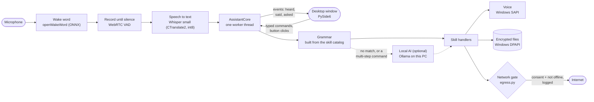
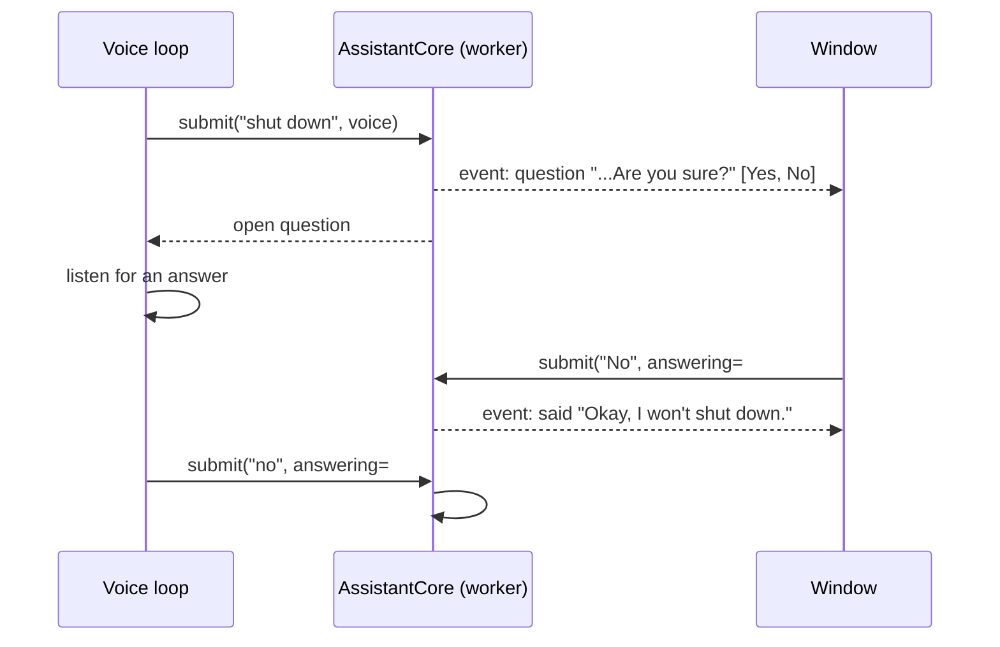

# How Ash is built

Ash is a Windows desktop assistant that runs its speech pipeline on the
PC: wake word, speech recognition, command handling and voice. This
page explains how the parts fit together and why they're arranged that
way. For what Ash stores and sends, see [PRIVACY.md](PRIVACY.md).

## The pipeline

| Stage | Module | Notes |
|---|---|---|
| Wake word | `ash/audio/wake_word.py` | openWakeWord's pretrained `hey_jarvis` model, 80 ms frames |
| Recording | `ash/audio/recorder.py` | WebRTC voice-activity detection cuts the command off after `audio.silence_ms` of silence. Also detects you talking over Ash (barge-in), and has a real microphone off switch that closes the audio stream. Audio stays in memory. |
| Speech to text | `ash/audio/stt.py` | faster-whisper (Whisper `small`, int8 on CPU). Loaded with `local_files_only` so it never contacts Hugging Face after the one-time download. |
| Understanding | `ash/nlu/grammar.py`, `ash/skills/` | Rule-based first (fast and predictable); the optional local AI only handles what the rules don't match |
| Doing | `ash/actions/` | One module per area: apps, timers, notes, weather, media, privacy, ... |
| Voice | `ash/audio/tts.py` | Windows SAPI on its own thread (COM isn't safe to call from arbitrary threads) |

Ash only runs pretrained models (it doesn't train any). The
accuracy of the speech model on a real user's voice is measured with
`scripts/stt_accuracy.py`, and latency with `scripts/benchmark.py`.

## One worker thread for every command

Commands arrive from three places at once: the microphone loop
(`ash/voice.py`), the chat box, and buttons in the window. Rather than
making the dispatcher, the shared "it/that" context and every data file
thread-safe, `ash/core.py` runs every command on a single worker
thread, in the order it arrived. Callers get a `Future`.

The window reads and changes your data (privacy dashboard, settings)
the same way. Its reads and writes are queued on that worker thread
too, so a click can't race a command that's writing the same encrypted
file.

Follow-up questions ("Are you sure?", "Which app?") are kept open in
the core, not in whichever input asked them. That's why a question asked
by voice can be answered by voice, by typing, or by clicking Yes.
Each question has an id: if you click Yes while the microphone is still
recording your answer, the late spoken answer is recognized as stale
and dropped instead of running as a new command.

Everything Ash says, hears and asks is published as an event. The
window subscribes through a Qt signal (`ash/gui/bridge.py`), which hands
each event over to the GUI thread safely. Handlers don't know any of
this exists: they still just call `tts.say()`.

## Skills: each command declared once

Every command is declared once, in `ash/skills/catalog.py`, as a
`Skill` with:

- its handler
- its trigger phrases
- whether it needs confirmation, and the exact question it asks
- whether it can be one step of a multi-step command
- which online features it may use
- a description and example commands

The grammar, the dispatcher, the confirmation gates, the "what can you
do" answer and the window's "What can I say" tab are all generated from
that list. Adding a command is one declaration and one handler.

## Privacy layer

| Piece | Module | What it guarantees |
|---|---|---|
| Encrypted storage | `ash/privacy/secure_store.py` | Every personal file is encrypted with Windows DPAPI (tied to your Windows login) and written atomically |
| Data inventory | `ash/privacy/inventory.py` | Lists every file Ash keeps, with its purpose and how long it's kept. A test fails if Ash writes a file that isn't on the list. |
| Network gate | `ash/privacy/egress.py` | The only module allowed to import the HTTP library (a test enforces it). Each request must belong to a declared feature and website, is blocked in offline mode or without consent, and is logged. |
| Consent | `ash/privacy/consent.py`, `permission.py` | Asked once per online feature, saying what is sent and to whom. Can be withdrawn by voice or in the window. |
| Log redaction | `ash/privacy/redact.py` | Logs record which command ran, not what you said (unless you turn that on) |
| Your rights | `ash/actions/privacy_rights.py`, `ash/gui/privacy.py` | Inventory, export, and delete, by voice or in the window |

## Safety

- **Risky actions ask first**, and say what will happen before "Are you
  sure?". This covers shutting down, force-closing apps, clicking on
  screen, and deleting data. Anything other than a clear yes is treated
  as no.
- **Optional voice match** on those confirmations (a classical MFCC
  similarity check, `ash/security/voice_gate.py`).
- **One failing command can't stop Ash**: the core catches it, says
  so, logs the details, and keeps going.

## Tests

About 1,000 tests, run on Windows by GitHub Actions on every push
(`.github/workflows/tests.yml`), plus ruff for linting.

- **A safety net** (`tests/conftest.py`): no test can launch a real
  program, rescan the real Start Menu, make a network request, write to
  the registry, change Windows settings, or read or write your real
  data. Each test gets its own temporary data folder.
- **The window is tested headless** with Qt's offscreen platform, using
  a real `AssistantCore` and the real dispatcher.
- **Startup imports run in fresh processes**
  (`tests/test_startup_imports.py`). This catches native-library
  clashes that in-process tests can't see. It found a real one: the
  winrt packages bundle an older C++ runtime that broke the wake-word
  engine depending on import order.
- `python -m ash --selftest` loads every real engine (wake word,
  speech recognition, voice, encryption, window) without speaking,
  listening or downloading. It's used to verify the packaged build.

## Packaging

`scripts/build_release.py` builds a PyInstaller folder app (`Ash.exe`)
and zips it. The speech models aren't in the zip: on first start the
window asks before downloading them. Both downloads are checked against
offline mode and logged. The wake-word models carry their own
non-commercial licence, and the speech model is a few hundred MB.
`.github/workflows/release.yml` builds and attaches the zip when a
version tag is pushed.
